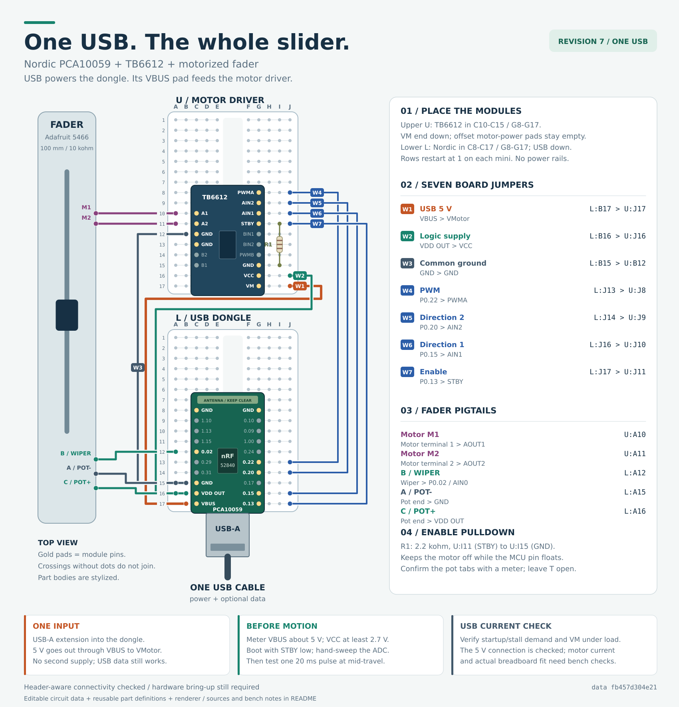
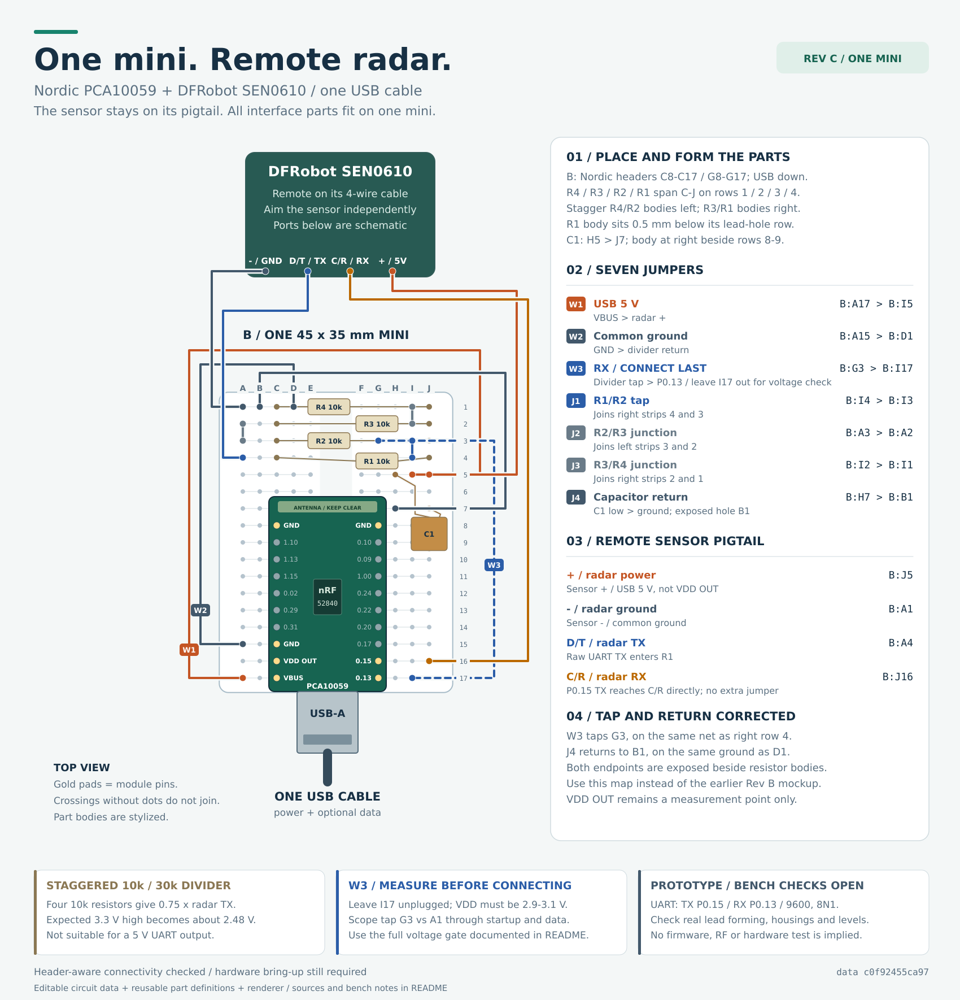

# Breadboard Diagrams

Reusable, data-driven assembly drawings for small physical builds. The first
circuit is Gavin's motorized fader, revised to use **one USB cable into the
Nordic PCA10059**. The dongle's raw USB **VBUS** pad feeds the TB6612 motor
supply. `VDD OUT` remains the separate low-voltage logic and potentiometer rail.



## Run from a fresh session

This project lives in `breadboard-diagrams/` on the `breadboard-diagrams` branch
of [guinn8/Scripts](https://github.com/guinn8/Scripts/tree/breadboard-diagrams/breadboard-diagrams).
Give a future ChatGPT/Codex session that link and ask it to read this file and
`AGENTS.md`, modify the circuit JSON, validate, render and inspect the result.
The source is in Git; a previous chat's temporary files are not required.

```sh
git clone --branch breadboard-diagrams https://github.com/guinn8/Scripts.git
cd Scripts/breadboard-diagrams
python3 -m venv .venv
.venv/bin/pip install -r requirements.txt
.venv/bin/python -m breadboard_diagrams circuits/slider-single-usb.json --out output
```

On Ubuntu the exporters use DejaVu fonts (`fonts-dejavu-core`). Override the
font directory with `BREADBOARD_FONT_DIR`. SVG export and electrical checks use
only the Python standard library; Pillow is needed for PNG and ReportLab for
PDF. Dependencies are pinned to the versions used for this delivery.

```sh
python3 -m breadboard_diagrams circuits/slider-single-usb.json --check
python3 -m breadboard_diagrams circuits/slider-single-usb.json --out output --formats svg
python3 -m unittest discover -s tests -v
```

Outputs include SVG, a high-resolution PNG, a vector PDF, a wiring CSV, a full
module-header pinmap CSV and a validation JSON. The PDF uses the diagram's
vector artboard; choose Fit to Page when printing. The illustration is top view.
Component bodies are stylized, not exact mechanical envelopes.

## Reuse

| File or directory | Responsibility |
|---|---|
| `breadboard_diagrams/model.py` | Hole coordinates, connected strips, conductive paths and validation |
| `breadboard_diagrams/render.py` | Shared drawing primitives and SVG/PNG/PDF exporters |
| `parts/*.json` | Reusable module/header definitions and manufacturer provenance |
| `circuits/*.json` | Per-build placement, nets, wires, routes, annotations and bench assumptions |
| `tests/test_connectivity.py` | Fault injections for misplaced wires, shorts, opens and duplicate holes |
| `examples/slider-single-usb.svg` | Committed preview generated from the same source |

`examples/vbus-tap.json` is an independent one-board example that reuses the
same Nordic and breadboard definitions without modifying the renderer. Run it
with the same command, changing only the input JSON path.

The one-board radar build is `circuits/radar-one-board.json`; its remote sensor
is defined once in `parts/dfrobot-sen0610.json`. Run:

```sh
python3 -m breadboard_diagrams circuits/radar-one-board.json --out output/radar
python3 -m breadboard_diagrams circuits/radar-one-board.json --check
```



External parts can select `drawing: "panel"` in their part definition, with
titles, pin labels and port colours. An instance provides its schematic port
positions and detail lines. Passives can provide a `drawing` object containing
`body_center`, `body_size`, `orientation`, `lead_routes` and `label` to show
horizontal staggered resistors or formed capacitor leads. These drawing routes
never create conductive junctions; only the component's `a`/`b` holes attach it
to the electrical model. Optional wire `dash` lengths mark a connection to fit
after a bench check. The checker validates the complete intended assembly, not
its intermediate disconnected bring-up state.

Copy a circuit JSON for the next build. A breadboard origin and pitch set its
visual position. Hole references such as `L:B17` resolve through the board
definition. Component references such as `nrf.VBUS` resolve to their occupied
header holes. An instance can shift a module's rows or map header columns.
Every header pad, including unused GPIO and duplicate grounds, participates in
the electrical model. GPIO reassignment must update both the wires and the
explicit intended net labels.

Wires join their endpoint strips. Their drawing routes are independent of the
electrical topology, so an insulated crossing is not a junction. To join three
wires, use three distinct holes on the same strip. Resistors are components,
not conductive shorts. This is a focused assembly renderer and connectivity
checker; it does not simulate motor dynamics, power integrity or RF behavior.

## Slider revision 7

Placement and control pins are preserved from the saved version-6 image and
version-5 wiring handoff. The Adafruit 4090 USB-C breakout and its two power
jumpers are removed. The replacement power jumper is:

**W1: lower B17 (dongle VBUS) to upper J17 (driver VMotor).**

| ID | Function | From | To |
|---|---|---|---|
| W1 | USB 5 V | L:B17 / VBUS | U:J17 / VMotor |
| W2 | Logic supply | L:B16 / VDD OUT | U:J16 / VCC |
| W3 | Common ground | L:B15 / GND | U:B12 / GND |
| W4 | PWM | L:J13 / P0.22 | U:J8 / PWMA |
| W5 | Direction 2 | L:J14 / P0.20 | U:J9 / AIN2 |
| W6 | Direction 1 | L:J16 / P0.15 | U:J10 / AIN1 |
| W7 | Enable | L:J17 / P0.13 | U:J11 / STBY |
| F1 | Motor terminal 1 | Fader M1 | U:A10 / AOUT1 |
| F2 | Motor terminal 2 | Fader M2 | U:A11 / AOUT2 |
| F3 | Wiper, user tape B | Fader wiper | L:A12 / P0.02 / AIN0 |
| F4 | Pot low, user tape A | Fader pot end | L:A15 / GND |
| F5 | Pot high, user tape C | Fader pot end | L:A16 / VDD OUT |
| R1 | 2.2 kohm pulldown | U:I11 / STBY | U:I15 / GND |

The two Olimex minis have independent row numbering. Within a row, A-E is one
connected strip and F-J is another; there are no power rails. TB6612 placement
is upper C10-C15 / G8-G17, VM end down. PCA10059 placement is lower C8-C17 /
G8-G17, USB down. The TB6612's separate offset motor-power pads stay empty.

The dongle needs no solder-bridge modification or firmware switch for raw USB
5 V on VBUS. Keep its factory SB1 open / SB2 closed. **Do not connect a second
5 V supply while ordinary USB is attached.** VDD OUT is not a 5 V pin.

## Bench acceptance

1. Unpowered, verify the strips and wire endpoints with a meter; confirm there
   is no short among VBUS, VDD OUT and ground. Confirm the pot ends and wiper.
2. Use firmware that boots with STBY low. Meter VBUS near 5 V and driver VCC
   at least 2.7 V. A suitable REGOUT0 setup is needed if VDD OUT is below that;
   it does not change the raw VBUS connection. Target 3.0 V logic for this build.
3. Hand-sweep the potentiometer and confirm monotonic ADC feedback and useful
   endpoint separation before driving the motor.
4. With the fader at mid-travel, use one bounded 20 ms pulse. Record ADC before
   and after, motor polarity, supply droop and any MCU reset. Keep STBY low on
   error. Avoid a stalled motor or repeated pulses into an end stop.
5. Check motor startup/stall demand against the actual USB source and power
   path before relying on a PC port. No motor-current guarantee is inferred
   from the fact that a 5 V pad exists. Adafruit reports 5 V operation while
   listing 6-10 V in the detailed motor specification; actual performance
   remains a bench measurement.

The external 2.2 kohm pulldown works against the breakout's onboard 10 kohm
STBY pullup. It gives about 0.18 x VCC while the MCU is high impedance.
Set STBY low to coast; PWM=0 with a drive direction selected can short-brake.
Touch sensing, BLE control and OTA firmware are not implemented by this library.

Validation covers header-aware connectivity and net separation, unique hole
occupancy, required paths and resistor attachment. It does **not** establish
USB current compliance, transient behavior, actual plug/housing clearance,
physical lead fit, firmware behavior or motor operation.

## Radar revision C: one mini, sensor on a pigtail

This build reuses the same PCA10059 and Olimex definitions. The SEN0610 stays
remote; only the nRF, four 10 kohm resistors and a 100 nF ceramic occupy the
single mini breadboard. Its USB-A cable supplies the radar from raw VBUS 5 V.
VDD OUT is only a test point. The sensor's UART mode switch must be set to UART.
The physical pigtail port order in the illustration is schematic: identify
+, -, D/T and C/R from the board labels and continuity, not cable colour.

| Lead | Sensor function | Breadboard hole |
|---|---|---|
| F1 | + / power | B:J5 |
| F2 | - / ground | B:A1 |
| F3 | D/T / sensor TX | B:A4 |
| F4 | C/R / sensor RX | B:J16 |

The generated wiring CSV lists every jumper and passive. Nordic headers remain
C8-C17 / G8-G17 with USB down. R4/R3/R2/R1 span C-J on rows 1/2/3/4.
Stagger R4/R2 body centres 3.6 mm left of the span midpoint, R3/R1 3.6 mm
right. Form R1's body 0.5 mm down from its lead-hole row to give the tap
header above it more room. C1 leads enter H5/J7; form its body beside rows
8-9 at the right edge. Check actual capacitor dimensions/lead lengths,
connector housings, bare leads and USB socket against the drawing before
fixing the assembly. Breadboard outline and header centres are proportional;
module bodies remain stylized, not exact mechanical envelopes.

**Two corrections from the earlier Rev B mockup:** W3 now starts at G3 rather
than H4, on the same divider-tap net. J4 now ends at B1 rather than E1, on the
same ground net. H4 and E1 lay beneath resistor bodies. Use this source and
its regenerated diagram instead of the earlier raster's hole map. The MCU
assignments remain TX=P0.15 and RX=P0.13. The migration does not change the
voltage-divider circuit or claim that its signal-level assumptions are tested.

### Radar voltage gate and bring-up

R1 is 10 kohm in series with sensor TX. R2+R3+R4 provide 30 kohm to ground;
W3 taps their junction with R1. The nominal divider ratio is 0.75. A nominal
3.3 V TX high therefore becomes 2.475 V; with 5% resistors the ratio can span
0.731-0.768. **This is not a universal 5 V level converter.** A 5 V UART high
would be too high for the intended 3.0 V MCU supply. Public sensor material
checked does not specify UART VOH/VOL or C/R RX VIH; actual measurements and
a successful command/reply on this unit remain necessary.

1. Unpowered, check strips, pin labels and all endpoints. With the sensor
   unplugged and W3 disconnected at I17, expect about 40 kohm from A4 to
   ground, and 30 kohm from G3 to ground. Verify no VBUS/VDD/GND short.
2. Set the radar switch to UART and connect its labelled pigtail. Power only
   through the dongle USB. Measure A16 versus A15: this revision requires
   measured VDD of 2.9-3.1 V. Check radar supply J5 versus A1 near USB 5 V.
3. Keep W3 out at I17. Scope G3 versus A1 through startup and UART activity.
   Require divided HIGH >= 0.7 x measured VDD + 0.1 V and <= VDD - 0.1 V,
   LOW <= 0.3 V, and no startup peaks outside 0..VDD. At VDD 3.0 V that HIGH
   window is 2.2-2.9 V. A DC multimeter alone cannot verify peaks or data.
   If the gate fails, leave W3 out and revise the interface.
4. Power off before fitting W3. Firmware contract: TX=P0.15, RX=P0.13,
   9600 baud, 8 data bits, no parity, 1 stop bit, no flow control, RX pull
   disabled. Preserve the existing USB DFU bootloader and image offset.
   Use the official DFRobot_C4001 source for SEN0610 commands. Prove a real
   command/reply before interpreting occupancy, then verify entry/exit
   transitions and a power cycle. No firmware is included in this project.

`interface_gate`, `firmware_contract`, `mechanical_notes` and `bench_unknowns`
in the circuit JSON retain those assumptions for future sessions. The committed
validation report checks topology; the review evidence records the actual
checks run and their limits. Neither establishes hardware qualification.

## Manufacturer references

- [Nordic VBUS and internal regulator](https://docs.nordicsemi.com/r/bundle/ug_nrf52840_dongle/page/ug/nrf52840_dongle/hw_power_internal_regulator.html)
- [Nordic external regulated supply and solder bridges](https://docs.nordicsemi.com/r/bundle/ug_nrf52840_dongle/page/ug/nrf52840_dongle/hw_power_ext_reg_source.html)
- [Nordic PCA10059 production hardware](https://www.nordicsemi.com/Products/Development-hardware/nrf52840-dongle/download)
- [Adafruit TB6612 board source](https://github.com/adafruit/Adafruit-TB6612-Motor-Driver-Breakout-PCB/blob/master/Adafruit%20TB6612.brd), blob `17df1afba1d4e98543dde18b57d9bcaed180659d`
- [Adafruit TB6612 pinouts](https://learn.adafruit.com/adafruit-tb6612-h-bridge-dc-stepper-motor-driver-breakout/pinouts)
- [Toshiba TB6612FNG datasheet](https://toshiba.semicon-storage.com/info/TB6612FNG_datasheet_en_20141001.pdf?did=10660&prodName=TB6612FNG)
- [Adafruit motorized fader 5466](https://www.adafruit.com/product/5466)

- [DFRobot SEN0610 interface](https://wiki.dfrobot.com/sen0610/)
- [DFRobot C4001 protocol implementation](https://github.com/DFRobot/DFRobot_C4001)
- [Yageo CFR-25 body dimensions, page 3](https://uploadcdn.oneyac.com/attachments/files/brand_pdf/yageo/E2/B5/YAGEO_CFR_datasheet_2024v3.pdf)

The part drawings and renderer are newly authored. Manufacturer CAD is linked
for provenance, not copied into the source tree. This README's circuits and
checks are design inputs, not a claim of hardware qualification.
